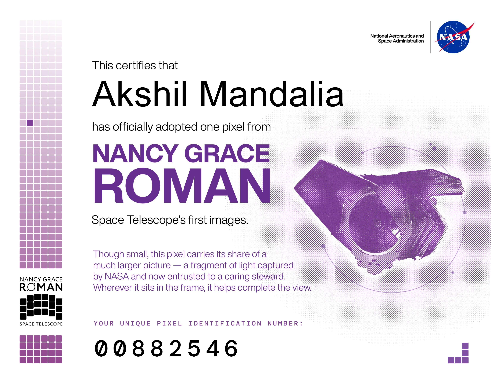

# 🚀 NASA – Nancy Grace Roman Space Telescope

## 🏆 Certificate of Achievement

I'm proud to share my achievement related to NASA's Nancy Grace Roman Space Telescope.

This certificate represents my interest in space exploration, astronomy, science, and technological innovation.

### 📜 Certificate

### 🌌 About the Mission

The Nancy Grace Roman Space Telescope is a NASA space observatory designed to explore the universe and investigate dark energy, exoplanets, and infrared astrophysics.

---

**Achievement:** Certificate of Achievement  
**Organization:** NASA  
**Mission:** Nancy Grace Roman Space Telescope
